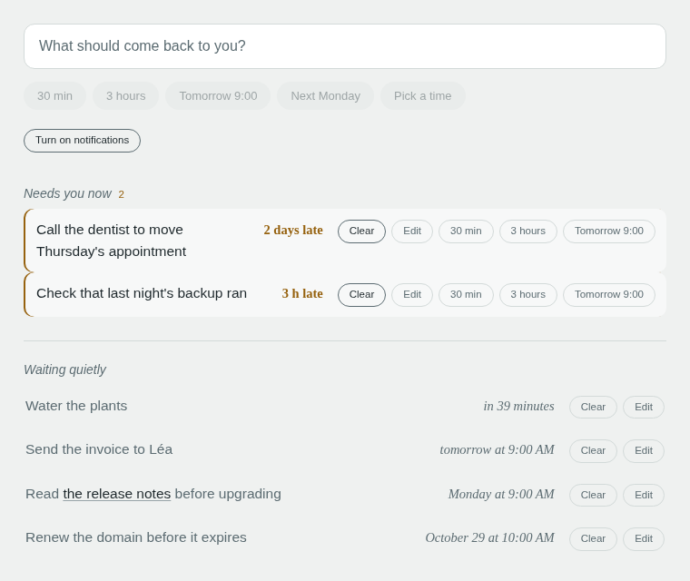

# Nag

Nag is a personal, self-hosted reminder app. You type a note, tap when it
must come back, and get an OS notification at that time.

<picture>
  <source media="(prefers-color-scheme: dark)" srcset="docs/screenshot-dark.png">
  
</picture>

- **Capture.** Type the text, then tap a chip: "30 min", "Tomorrow 9:00",
  or "Pick a time" for the date and time picker. The tap saves the
  reminder. Enter alone uses the default preset.
- **Waiting quietly.** Reminders that are not due yet. They stay in the
  background.
- **Needs you now.** Reminders that are due. When a reminder becomes due,
  nag sends a notification. The reminder then stays in this list until you
  clear it. If you dismiss the notification, the reminder stays.
- **Act on a row.** Clear or edit any row. An overdue row also has chips
  that move it later with one tap. The tab title and the app badge show
  the number of overdue reminders.

Nag has one user and runs one instance. It is a single Go binary with
SQLite, shipped as a container image. [docs/SPEC.md](docs/SPEC.md) is the full
specification.

## Try it on your laptop

You can try nag in Chrome or Firefox with Docker only. Browsers treat
`localhost` as secure, so notifications work without HTTPS or a domain.

```
mkdir nag-try
docker run --rm ghcr.io/kamalf/nag genkeys > nag-try/nag.env
```

In `nag-try/nag.env`, replace `mailto:you@example.com` with your own
address. Then start nag:

```
docker run --rm -p 127.0.0.1:8080:8080 --env-file nag-try/nag.env \
  --user "$(id -u):$(id -g)" -v "$PWD/nag-try:/data" \
  -e NAG_CONFIG=/data/nag.toml ghcr.io/kamalf/nag
```

Open http://localhost:8080 and enter the value of `NAG_TOKEN` from
`nag-try/nag.env`. Then click "Turn on notifications".

- The database and the configuration are in `nag-try/`. To stop nag, press
  Ctrl+C. The same command starts it again with your reminders.
- The default timezone is `Europe/Paris`. To change it, edit `timezone` in
  `nag-try/nag.toml`, then start nag again.
- Notifications arrive only while nag runs. A phone cannot reach your
  laptop, and Safari does not treat `localhost` as secure. For a phone,
  install nag on a server as described below.

## Before you start

You need Docker with Compose, a domain name, and an HTTPS reverse proxy on
the same host. HTTPS is mandatory: service workers and Web Push do not work
over plain HTTP.

`compose.yaml` publishes nag on `127.0.0.1:8080` only, so only the host
can reach it. Point your proxy at that address. With [Caddy], this is the
full site block:

```
nag.example.com {
    reverse_proxy 127.0.0.1:8080
}
```

Other proxies work the same way. The proxy must pass the original `Host`
header through. Caddy does this by default. With nginx, add
`proxy_set_header Host $host;`.

If you use [caddy-docker-proxy], read
[With caddy-docker-proxy](#with-caddy-docker-proxy) before the setup
commands.

Put two files from this repository in one directory: `compose.yaml` and
`nag.env.example`. A clone is the easiest way to get them. The image comes
from `ghcr.io/kamalf/nag`. To build it yourself, see [Building](#building).

[Caddy]: https://caddyserver.com/
[caddy-docker-proxy]: https://github.com/lucaslorentz/caddy-docker-proxy

## Setup

Run these four commands in the project directory, in this order:

```
mkdir -p data config
sudo chown -R 65534:65534 data config
cp nag.env.example nag.env
docker compose run --rm -T nag genkeys >> nag.env
```

1. `data/` holds the database and `config/` holds `nag.toml`. Both are bind
   mounts.
2. The image runs as uid 65534 and has no shell, so you cannot change
   the ownership from inside the container. Do it once, here.
3. Compose refuses to run any command while `nag.env` is missing, `genkeys`
   included. So the file must exist before you run `genkeys`.
4. `genkeys` writes a complete env file to stdout. **Keep `-T`.** Without
   `-T`, some Compose versions allocate a TTY. The TTY changes each line
   ending to `\r\n`, and the `\r` becomes part of each key.

Then do one manual edit. In `nag.env`, replace `mailto:you@example.com`
with your own address. Push services use this address to contact you. Nag
does not start while the placeholder is there.

Start nag:

```
docker compose up -d
```

On the first start, nag writes its default configuration to
`config/nag.toml`. The default timezone is `Europe/Paris`, and all presets
use it. Set `timezone` to your timezone, then reload (see
[Configuration](#configuration)).

Then open the site. Enter the value of `NAG_TOKEN` from `nag.env` once,
and click "Turn on notifications".

### iPhone

On iPhone, Web Push works only from a Home Screen app. Open the site in
Safari, then tap Share → Add to Home Screen. The installed app has its own
cookie storage, separate from Safari, so you type the token one more
time in the app. This is normal, not a failed login.

## With caddy-docker-proxy

`compose.caddy-docker-proxy.yaml` adds the external `caddy` network and the
proxy labels to `compose.yaml`. Turn it on once, before the setup commands.
Put a `.env` file next to `compose.yaml` (this is not `nag.env`):

```
echo 'COMPOSE_FILE=compose.yaml:compose.caddy-docker-proxy.yaml' > .env
```

Then change the `caddy:` label in `compose.caddy-docker-proxy.yaml` to your
domain. All other commands in this README stay the same.

With this file on, each `docker compose` command needs the `caddy` network,
the setup commands included. The file declares the network
`external: true`, so Compose does not create it. If the proxy does not run
yet, create the network first:

```
docker network create caddy
```

## Configuration

`config/nag.toml` holds the behavior: timezone, presets, the hours of the
picker, and retention. Comments in the file explain each setting. Secrets
stay in `nag.env`.

After an edit, check the file, then reload it without a restart:

```
docker compose run --rm nag config check
docker compose kill -s HUP nag
```

`config check` prints the preset list or the exact error. If a reload
finds an error, nag logs it and keeps the current configuration. So
always check the file before a reload.

## Channels (optional)

Nag can also send a reminder to ntfy, Telegram, Matrix, email, and the
other services that [shoutrrr] supports. Channel URLs contain secrets, so
they are in the database, and you manage them from the command line:

```
docker compose run --rm nag channel add ntfy 'ntfy://ntfy.sh/your-topic'
docker compose run --rm nag channel test ntfy
docker compose run --rm nag channel list
docker compose run --rm nag channel disable ntfy
docker compose run --rm nag channel rm ntfy
```

Names are lowercase slugs. `list` masks all URLs. In the app, select the
channels for each reminder with "Also send to".

[shoutrrr]: https://github.com/nicholas-fedor/shoutrrr

## If no notification arrives

Send a test notification to all subscribed browsers:

```
curl -X POST -H "Authorization: Bearer $NAG_TOKEN" https://nag.example.com/api/push/test
```

Before you run it, set `$NAG_TOKEN` in your shell to the value from
`nag.env`.

The reply gives a status for each subscription. `201` means that the push
service accepted the notification. The only other source of information is
the log: `docker compose logs nag`. The log never contains the token, a
channel URL, a full push endpoint, or reminder text.

## Backups

The database is the only copy of your data. While nag runs, recent writes
are in `nag.db-wal`. Thus a copy of `nag.db` alone from a running instance
can be corrupt. Either stop the container first:

```
docker compose stop nag
cp data/nag.db* /your/backup/
docker compose start nag
```

A clean stop writes the WAL back into `nag.db` and removes the `-wal` and
`-shm` files. The glob copies the files that are there. Or use `VACUUM
INTO` from your own backup tool.

Keep `data/` on a local disk. WAL does not work reliably on a network
filesystem.

## Updating

```
docker compose pull
docker compose up -d
```

`up -d` alone uses the image that is already on the host. `docker compose
run --rm nag version` prints the version, and the start-up log shows it.

## Building

GitHub Actions builds the release images. A tag such as `v0.2.0` publishes
`ghcr.io/kamalf/nag:0.2.0` and `:latest` for amd64 and arm64.

To build from a clone:

```
docker compose build --build-arg VERSION=$(git describe --tags --always --dirty)
```

The local build uses the same name, `ghcr.io/kamalf/nag:latest`. Thus the
next `docker compose pull` replaces it with the released image. The version
`dev` means that the build did not get the `VERSION` argument. If Compose
cannot pull the image, it builds the image from the clone on first use.

For local development, use the Go version in `mise.toml`. `go test ./...`
runs all tests. The frontend has no build step and no test runner.
